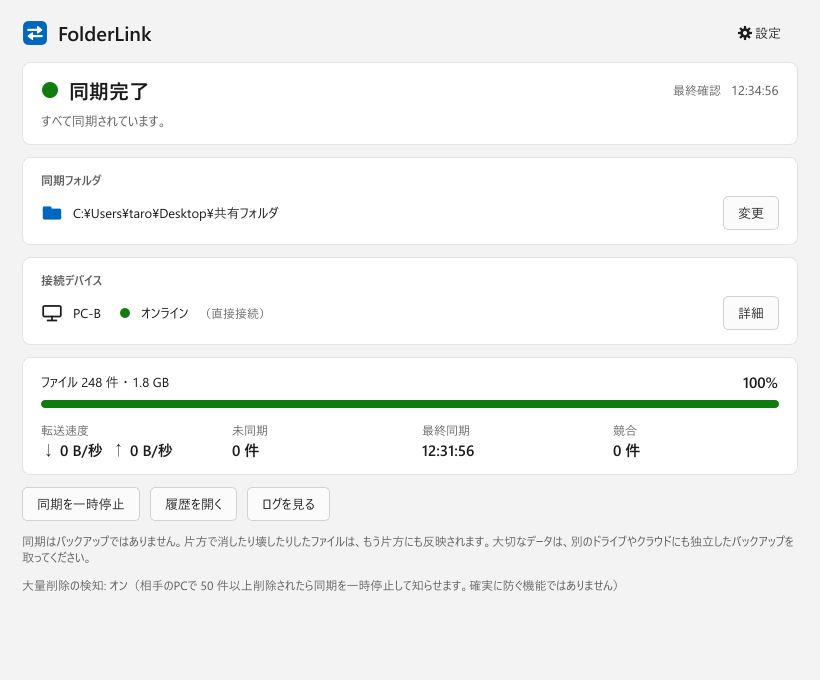
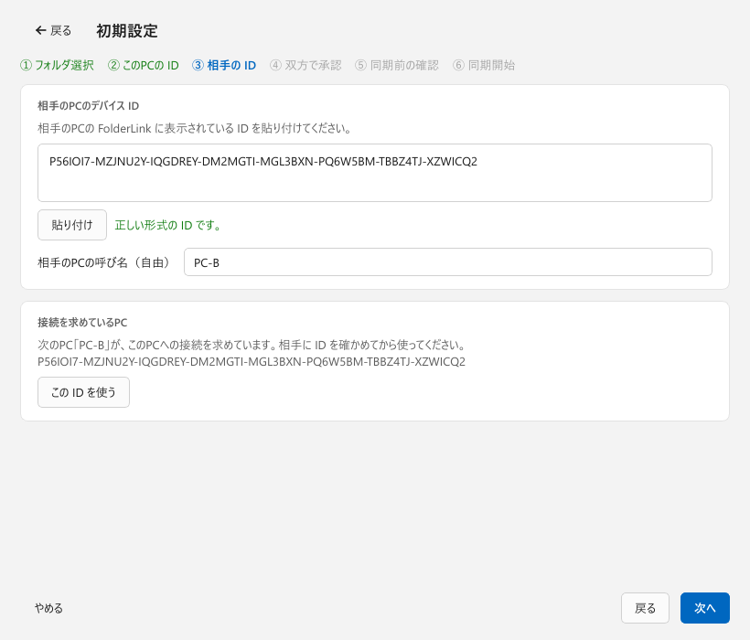
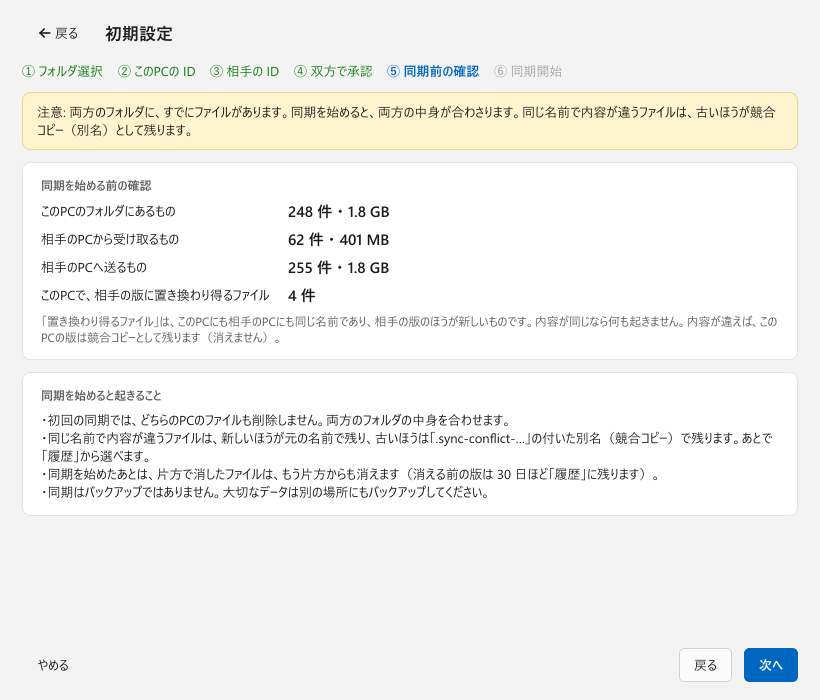

# FolderLink

離れた2台の Windows PC にある1つのフォルダを、インターネット経由で自動・双方向に同期するデスクトップアプリです（Windows 10 / 11）。
大きな動画や Unity などの開発データを想定しています。同期エンジンには [Syncthing](https://syncthing.net/) を使い、FolderLink はペアリング・フォルダの設定・状態の表示・競合と履歴・警告・起動の管理を受け持ちます。



> **同期はバックアップではありません。** 片方の PC でファイルを消したり壊したりすると、その変更はもう片方にも届きます。大切なデータは、別のドライブやクラウドにも独立したバックアップを取ってください。

## 現状について（必ずお読みください）

- **現状のまま公開しています。今後の更新・不具合対応・サポートの予定はありません。**
- 自動テストと、1台の PC の中で2つの同期エンジンを動かすテストで確かめています。**別々のネットワークにある実機2台での受け入れテストは行っていません**（下の「確認できていないこと」）。
- 同梱の Syncthing は **v2.1.7 に固定**しており、自動では更新されません。安全のため、新しい版が出たら「Syncthing の差し替え方」の手順で利用者自身が差し替えてください。
- アプリ内に自動更新・更新確認の機能はありません。

## できること

- 2台の PC のフォルダを双方向に同期（追加・更新・名前変更・削除）。PC ごとにフォルダの場所が違っていてもかまいません。
- 相手の PC がオフラインのあいだの変更は、再接続したときに追いつきます。直接つながらない場合は Syncthing のリレーを経由します（速さは保証されません）。
- **競合コピーを残す**: 2台で同じファイルを同時に変更しても、片方の変更を黙って消しません。`<名前>.sync-conflict-<日時>-<PC>.<拡張子>` という名前で残し、「同期履歴・競合」画面でどちらを残すかを選べます。選ばなかったほうも削除せず、過去の版に移します。
- **過去の版**: 相手の PC の変更で上書き・削除されたファイルの直前の版を 30 日間（初期値）残し、画面から戻せます（Syncthing の staggered バージョニング）。
- **初回同期前のプレビュー**: 同期を始める前に、両方のフォルダのファイル数・容量と、内容が置き換わり得るファイルの数を表示します。中身のあるフォルダ同士をつなぐときは警告します。
- **大量削除の検知**: 相手の PC で一度にたくさんのファイル（初期値 50 件以上）が削除されたことを検知すると、同期を一時停止して知らせ、「削除されたファイルを戻す」か「削除を受け入れる」かを選べます。**確実に防ぐ機能ではありません**（少しずつ削除された場合などは、止まる前に一部が削除されます。削除されたファイルは過去の版から戻せます）。
- Unity 用などの除外プリセット（`Library/` `Temp/` `Obj/` `Logs/` `Build/` `Builds/` `.vs/` など。`Assets/` `Packages/` `ProjectSettings/` は同期します）。個別に追加もできます。
- 通知領域に常駐し、ウィンドウを閉じても同期を続けます（終了は通知領域のアイコンを右クリック →「終了」）。Windows へのサインイン時の自動起動（設定で切り替え）。
- ライト／ダーク表示、高 DPI 対応。

## インストール

1. [Releases](../../releases) から `FolderLink_Setup.exe` をダウンロードして実行します（管理者権限は不要。既定のインストール先は `%LOCALAPPDATA%\Programs\FolderLink`）。
2. Windows の SmartScreen が警告を出すことがあります（署名していないため）。内容を確認したうえで「詳細情報」→「実行」を選んでください。
3. 「サインインしたときに起動する」を選ぶと、ログイン時に通知領域で起動します。

アンインストールは「設定 → アプリ」から行います。アンインストールしても、**同期フォルダの中のファイルと、FolderLink の設定（`%LOCALAPPDATA%\FolderLink`。同期エンジンの鍵を含む）は残ります**。不要なら手で削除してください。

## 2台の設定のしかた

両方の PC に FolderLink を入れて起動すると、初期設定が始まります。

1. **フォルダを選ぶ**（両方の PC で。場所は PC ごとに違ってかまいません）。必要なら除外プリセットを選びます。
2. **このPCの ID** が表示されます。「コピー」を押して、メールやチャットなどで相手に伝えます（ID は秘密ではありません。こちらが承認しない限り接続されません）。
3. **相手の ID を貼り付けます**。入力ミスはチェック文字で見つけて知らせます。
   
4. **両方の PC で承認**します。両方で相手を登録すると接続されます。
5. **同期前のプレビュー**で、両方のフォルダの中身と、置き換わり得るファイルを確認します。この時点ではどちらのファイルも変更されません。
   
6. **同期を開始**します。両方のフォルダの中身が合わさります（どちらにしか無いファイルは、もう片方にコピーされます）。

設定のあとは、ダッシュボードで状態（同期完了／同期中／オフライン／一時停止／競合あり／エラー など）、完了率、転送速度、未同期の件数、最後に同期した時刻を確認できます。取得できない値は「—」と表示します。

## 注意事項

- **同期はバックアップではありません**（冒頭のとおり）。
- **過去の版は「相手の PC から届いた変更」の直前の版だけです。** 自分の PC で自分が上書き・削除したファイルの直前の版は、相手の PC 側に残ります。また、短時間に何度も上書きした場合、途中の版は残りません（最初の1時間は30秒に1つ）。
- 過去の版は同期フォルダの中の `.stversions` に保存され、その分のディスク容量を使います（大きなファイルを何度も差し替えると、その分増えます）。履歴画面に使用量を表示します。
- 大文字と小文字だけが違う同じ名前のファイルが2台にそれぞれあると、同期が止まってエラーになります（Windows では区別できないため）。画面の案内に従って、どちらかの名前を変えてください。
- 別のアプリで開いている（ロックされている）ファイルは、閉じるまで更新されません。閉じると自動で続きを同期します。
- 2台の時計が大きくずれていると、競合時にどちらが「新しい版」になるかが期待と違うことがあります。

### Unity で使う場合

- 2台で**同じプロジェクトを同時に Unity Editor で開く使い方はおすすめしません**。シーンやプレハブが競合し、自動では統合されません（競合コピーとして残ります）。
- Unity 用の除外プリセットを使うと、`Library/` などの再生成できるフォルダを同期しません。
- 複数人・複数台での共同作業には、Git や Unity Version Control を併用してください。

## 確認できていないこと

| 項目 | 状態 |
|---|---|
| 別々のネットワークにある実機2台での同期（直接接続・リレー経由） | 未検証 |
| 1GB を超えるファイルの転送（テストは 100MB まで） | 未検証 |
| ディスクの空き不足、権限エラー、シンボリックリンク | 未検証 |
| 回線越しでの大量削除の検知が間に合うか | 未検証（1台の中では、一度に届いた 300 件の削除は適用前に止まり、少しずつの削除では 27 件が先に消えました） |
| 30日を過ぎた過去の版が実際に消えること | 未検証 |
| クリーンな Windows でのインストール・アンインストール・自動起動、実際の画面での表示、通知 | 未検証 |
| 長いパス（260 文字超）、使用中のファイル、大文字小文字だけの名前変更、ジャンクション | 1台の中で確認済み |

## Syncthing について（ライセンス・入手先・差し替え方）

FolderLink は同期エンジンとして **Syncthing v2.1.7**（Windows amd64 版）を**改変せずに**同梱しています。Syncthing は [Mozilla Public License 2.0](https://mozilla.org/MPL/2.0/) で配布されています。

- ライセンス文: インストール先の `syncthing\LICENSE.txt`（作者一覧は `syncthing\AUTHORS.txt`）
- ソースコード: https://github.com/syncthing/syncthing/tree/v2.1.7
- 公式リリース: https://github.com/syncthing/syncthing/releases/tag/v2.1.7
- FolderLink は Syncthing プロジェクトの公式ソフトウェアではありません。
- ほかに使っているソフトウェアのライセンスは [THIRD_PARTY_NOTICES.md](THIRD_PARTY_NOTICES.md) にあります。

### Syncthing の差し替え方（新しい版にする）

FolderLink は Syncthing の自動更新を止めています（`--no-upgrade`）。セキュリティ修正などで新しい版にしたい場合は、次の手順で差し替えてください。**両方の PC で同じ版にそろえてください。**

1. https://github.com/syncthing/syncthing/releases で、新しい**安定版**（Pre-release でないもの）を確認します。リリースノートに破壊的な変更（特にメジャーバージョンの変更）がないかも確認してください。FolderLink は v2 系で作っています。
2. `syncthing-windows-amd64-<版>.zip` と `sha256sum.txt.asc` をダウンロードし、ZIP の SHA-256 が `sha256sum.txt.asc` に書かれた値と一致することを確かめます（PowerShell: `Get-FileHash <ZIPのパス> -Algorithm SHA256`）。
3. 通知領域のアイコンから FolderLink を「終了」します（同期エンジンも止まります）。
4. ZIP の中の `syncthing.exe`、`LICENSE.txt`、`AUTHORS.txt` などで、インストール先の `syncthing\` フォルダの中身を置き換えます（念のため、元のファイルは別の場所に控えておいてください）。
5. FolderLink を起動します。起動できない・状態が「エラー」になる場合は、控えておいた元のファイルに戻してください。

設定画面の「このアプリについて」に表示される版は、FolderLink を作ったときの版（v2.1.7）です。「接続先デバイス」画面の「同期エンジン」には、**相手の PC** で動いている版が表示されます。このPCで動いている版は、アプリのログ（「ログを見る」）の「同期エンジンを確認しました（… version=…）」の行で確認できます。

## 開発・ビルド

Windows 10/11、Python 3.11 以上、Git Bash を使います。

```bash
./Tools/setup_env.sh          # .venv を作り、PySide6・requests・pytest・pyinstaller などを入れる
./Tools/fetch_syncthing.sh    # 固定版の Syncthing を公式リリースから取得し、SHA-256 を照合して vendor/syncthing/ へ
./Tools/run_tests.sh          # 単体テスト（画面はオフスクリーン、エンジンは偽物）
./Tools/run_integration.sh    # 1台の中で2つの Syncthing を立てる結合テスト（_sandbox/ の中だけを使う）
./Tools/ui_shots.sh           # 各画面をオフスクリーンで描いて PNG に保存
./Tools/build_exe.sh          # PyInstaller で dist/FolderLink/FolderLink.exe を作り、起動確認まで行う
./Tools/build_installer.sh    # Inno Setup 6 で installer/Output/FolderLink_Setup.exe を作る
```

PowerShell 用に `scripts/build.ps1`・`scripts/package.ps1` もあります。

- テストで同期するフォルダと同期エンジンの設定は、すべてプロジェクト内の `_sandbox/` に作ります。既に動いている Syncthing（8384 番ポートなど）には接続せず、空いているポートを使い、自分で起動したプロセスだけを止めます。
- アプリは `python -m folderlink` でも起動できます（`--data-dir` で設定の保存先を変えられます）。

構成:

```
src/folderlink/
  app.py                 起動・通知領域・二重起動の防止
  core/                  Qt に依存しない部分
    syncthing_manager.py 専用ホームでのエンジンの起動・停止・本人確認（myID の照合）
    api_client.py        REST API（127.0.0.1 限定、API キーはログに出さない）
    pairing.py           デバイス ID の検証、登録、承認、フォルダの共有
    sync_status.py       状態の判定と表示用の数値
    history.py           過去の版の一覧・復元、競合の解決
    safety_guard.py      大量削除の検知と一時停止
    ignore_presets.py    除外プリセット（.stignore）
    config_store.py      設定（UI 設定と機密を分けて保存）
  ui/                    PySide6 の画面
tests/                   単体テスト／tests/integration/ は結合テスト
installer/FolderLink.iss Inno Setup のスクリプト
```

## ライセンス

FolderLink 自体は [MIT License](LICENSE) です（Copyright (c) 2026 ururuzawa）。同梱・依存するソフトウェアのライセンスは [THIRD_PARTY_NOTICES.md](THIRD_PARTY_NOTICES.md) を見てください。
